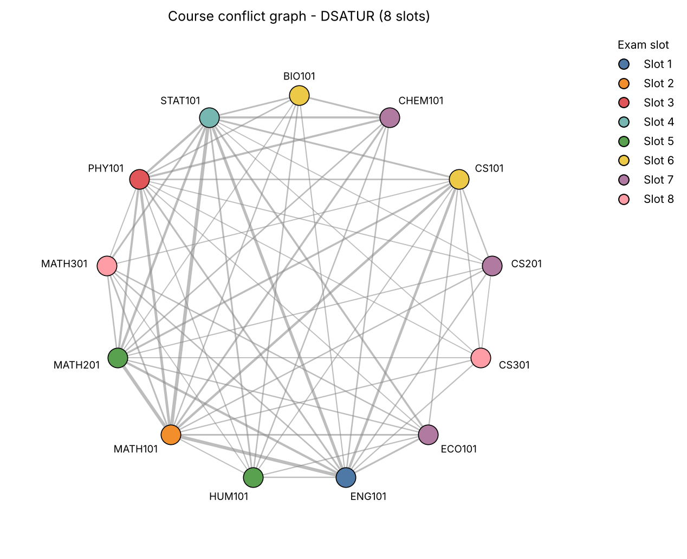

# ColorSlot

**Graph-based exam timetable planner.** ColorSlot reads student-course enrollments from a CSV file, builds a course conflict graph, and assigns exam slots with graph-coloring heuristics so that no student has two exams in the same slot.

The graph structure and all three coloring algorithms are implemented from scratch with the Python standard library (no NetworkX or other graph library).



## Problem statement

A university must schedule one exam per course. A student enrolled in two courses cannot sit both exams at the same time, so those two exams must go in different slots. Using few slots keeps the exam period short.

## Mathematical model

Let **G = (V, E)** be an undirected graph.

- Each vertex **v ∈ V** is one course (exam).
- An edge **(u, v) ∈ E** exists if and only if at least one student is enrolled in both `u` and `v`.
- The weight **w(u, v)** is the number of *distinct* students enrolled in both courses (used for reporting only).
- A **proper coloring** is a map `c: V → {1, 2, …}` with `c(u) ≠ c(v)` for every edge `(u, v)`.
- Each color is an exam slot, so a proper coloring is a conflict-free timetable.

Finding the *minimum* number of colors (the chromatic number) is NP-hard. ColorSlot therefore uses heuristics: every algorithm returns a **valid** coloring, but none is guaranteed to be **optimal**. The comparison report only says which algorithm used the fewest slots *on the given input*.

### From enrollments to a graph

1. Every distinct `course_id` becomes a vertex, including courses that share no students with any other course (isolated vertices).
2. Enrollments are stored as `course → set of students`, so duplicate rows cannot inflate counts.
3. For each student, every pair of their courses gains one shared student. Each unordered pair is stored once, so adjacency stays symmetric.
4. The edge weight is the final count for that pair.

## Algorithms

All three are deterministic and return `course_id → slot` with 1-based slot numbers.

| Algorithm | Vertex order | Rule |
|---|---|---|
| **Greedy** | ascending course ID | give each vertex the smallest color not used by its already-colored neighbors |
| **Welsh-Powell** | descending degree, ties by course ID | same first-fit rule, applied in that order |
| **DSATUR** | dynamic | repeatedly pick the uncolored vertex with the most distinct neighbor colors (saturation); ties go to the vertex with more uncolored neighbors, then to the smaller course ID; give it the smallest free color |

Notes:

- First-fit coloring never needs more than `max degree + 1` colors.
- DSATUR colors bipartite graphs optimally; greedy and Welsh-Powell may not (the test suite includes such a graph).
- The Welsh-Powell variant here follows the common "sort by degree, then first-fit" formulation rather than building one color class at a time.

## Technology stack

- Python 3.10+
- Standard library: `csv`, `argparse`, `dataclasses`, `time`
- [Matplotlib](https://matplotlib.org/) for the optional graph image (imported only when `--plot` is used)
- [pytest](https://pytest.org/) for tests

## Installation

```bash
git clone <your-repository-url>
cd ColorSlot
python -m venv .venv
source .venv/bin/activate        # Windows: .venv\Scripts\activate
pip install -e ".[plot]"         # core + Matplotlib for --plot
pip install -e ".[dev]"          # alternatively: adds pytest for running the tests
```

The core program has no dependencies, so `pip install -e .` is enough if you never use `--plot`. You can also run it without installing: `PYTHONPATH=src python -m colorslot ...`.

## Input format

A CSV with one row per student-course enrollment.

| Column | Required | Meaning |
|---|---|---|
| `student_id` | yes | student identifier |
| `course_id` | yes | course identifier |
| `course_name` | no | human-readable course name |

```csv
student_id,course_id,course_name
S001,MATH101,Mathematics
S001,PHY101,Physics
S002,MATH101,Mathematics
S002,CS101,Computer Science
S003,CS101,Computer Science
S003,STAT101,Statistics
```

Rules and validation:

- Identifiers are read as text, so leading zeros are kept (`007` stays `007`). IDs are case-sensitive and surrounding whitespace is trimmed.
- Header names are matched case-insensitively. A UTF-8 byte-order mark is accepted.
- Errors (reported with a line number where possible): missing file, empty file, header without data, missing required columns, duplicate column names, empty `student_id` or `course_id`, control or invisible characters in IDs, invalid UTF-8, and the same `course_id` given two different names.
- Repeated enrollment rows are ignored and reported; they never change conflict counts.

A realistic dataset (72 students, 13 courses) is included at `data/sample_enrollments.csv`.

## Usage

```bash
python -m colorslot --input data/sample_enrollments.csv --algorithm dsatur --output-dir output --compare --plot
```

| Option | Description |
|---|---|
| `-i, --input CSV` | enrollment file (required) |
| `-a, --algorithm {greedy,welsh-powell,dsatur}` | algorithm for the exported timetable (default `dsatur`) |
| `-o, --output-dir DIR` | output directory, created if missing (default `output`) |
| `--compare` | run all three algorithms and write `comparison.csv` |
| `--plot` | write `network.png` (needs Matplotlib; works without a display) |
| `--version`, `-h` | version / help |

With `pip install`, the same program is available as the `colorslot` command. Exit codes: `0` success, `1` input or runtime error (message on stderr), `2` invalid command-line arguments.

## Output files

| File | Contents |
|---|---|
| `schedule.csv` | `course_id, course_name, slot_number, slot_name, degree`, sorted by slot then course. Written only after the coloring passes validation. |
| `conflicts.csv` | `course_a, course_b, shared_students` for every conflicting pair |
| `comparison.csv` | `algorithm, slots_used, execution_time_ms, valid` (with `--compare`) |
| `network.png` | conflict graph, circular layout, vertices colored by slot, with legend (with `--plot`) |

The terminal also shows graph statistics (courses, edges, maximum and average degree, density, connected components, most conflict-heavy courses) and the courses grouped by slot.

## Example run

```text
$ python -m colorslot -i data/sample_enrollments.csv --compare
Loaded 360 enrollment rows: 72 students, 13 courses

Graph analysis
  Courses (vertices):     13
  Conflict edges:         61
  Maximum degree:         12
  Average degree:         9.38
  Graph density:          0.782
  Connected components:   1
  ...

Exam timetable (DSATUR): 8 time slot(s)
  Slot 1:
    ENG101 - Technical Communication
  Slot 2:
    MATH101 - Calculus I
  ...
  Slot 7:
    CHEM101 - General Chemistry
    CS201 - Data Structures
    ECO101 - Microeconomics
  Slot 8:
    CS301 - Algorithms
    MATH301 - Probability Theory

Validation: PASSED (DSATUR, 8 slot(s), 0.150 ms)

Algorithm comparison
| Algorithm    | Time Slots | Execution Time | Valid Schedule |
|--------------|------------|----------------|----------------|
| Greedy       | 9          | 0.028 ms       | Yes            |
| Welsh-Powell | 8          | 0.033 ms       | Yes            |
| DSATUR       | 8          | 0.083 ms       | Yes            |
Fewest slots on this input: Welsh-Powell, DSATUR (8).
Note: these are heuristics; a valid coloring is not proven to be optimal.
```

Execution times vary from run to run; colorings do not.

## Project structure

```text
ColorSlot/
├── data/sample_enrollments.csv
├── docs/example_network.png
├── src/colorslot/
│   ├── __init__.py
│   ├── __main__.py        # python -m colorslot
│   ├── cli.py             # argparse interface and run flow
│   ├── data_loader.py     # CSV reading and input validation
│   ├── graph.py           # ConflictGraph and graph construction
│   ├── coloring.py        # Greedy, Welsh-Powell, DSATUR
│   ├── metrics.py         # graph statistics, timing, algorithm comparison
│   ├── validation.py      # independent coloring validator
│   ├── exporter.py        # CSV export and text reports
│   └── visualization.py   # optional Matplotlib rendering
├── tests/
├── output/                # generated files (git-ignored)
├── pyproject.toml
└── README.md
```

## Testing

```bash
pip install -e ".[dev]"
python -m pytest
```

The tests check mathematical properties, not just that code runs: graph size, edge weights, symmetry and degrees; validity of all three algorithms on the sample data and on 60 seeded random graphs (including the `max degree + 1` bound); triangle = 3 colors, path = 2, edgeless = 1; DSATUR's selection rules; rejection of invalid schedules by the validator and exporter; input validation; duplicate handling; exported CSV contents; and the command line end to end.

## Limitations and future work

- Heuristics only: a valid schedule is not proven to use the minimum number of slots. An exact method (for example branch and bound) could certify optimality on small inputs.
- Only student conflicts are modeled. Room capacity, exam duration, invigilator availability and fixed-slot constraints are not.
- Slots are abstract numbers; there is no mapping to dates or times, and no attempt to spread a student's exams across days.
- The circular plot gets crowded beyond roughly 40 courses, and edge weights are labeled only on small graphs.
- Course and student IDs are case-sensitive (`cs101` and `CS101` are different courses).
- DSATUR as implemented scans all uncolored vertices at each step, which is fine for hundreds of courses but not tuned for very large graphs.
